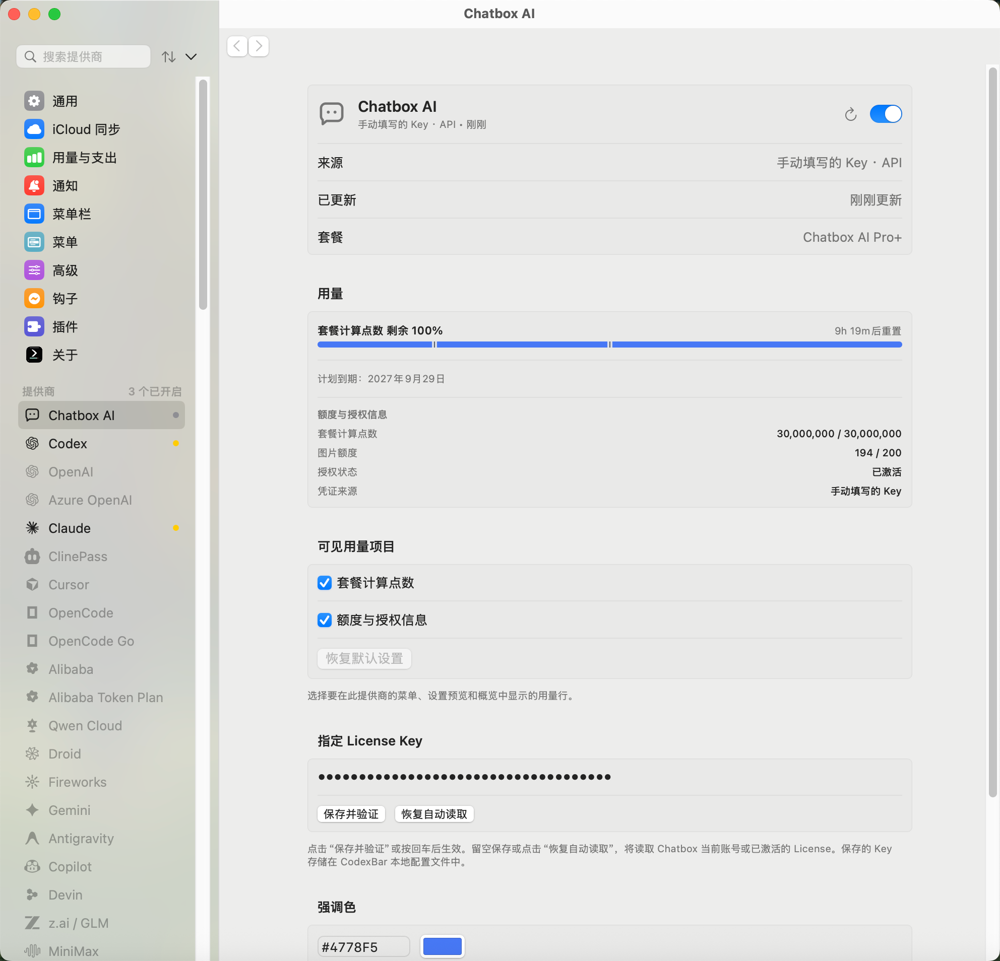

# Chatbox AI

Chatbox AI is disabled by default. Enable it in Settings → Providers after signing in and selecting a
license in the Chatbox desktop app, or activating a license key there. On macOS, CodexBar reads the current
`settings.licenseKey` from `~/Library/Application Support/xyz.chatboxapp.app/config.json` on each refresh.
Both account login and manual activation populate this field. Account access and refresh tokens are not read.
CodexBar does not activate or deactivate devices, change Chatbox settings, or copy the discovered key into its config.
An empty or unreadable current key remains unavailable; remembered keys and inspected license details are not used.

Enter a **License key override** in CodexBar to use a different license, then click **Save and verify**
or press Return. Edits remain in memory until submission. Verification refreshes usage and reports its
result beneath the field. **Restore automatic detection**, or submitting an empty field, clears the saved
override and immediately refreshes using app discovery. A failed verification keeps the saved override
and shows a failure message; it does not claim that old balances validate the new key.
Malformed explicit keys, including embedded whitespace or control characters and keys larger than 4096 bytes,
are rejected before requesting usage and do not fall back to app discovery.
`CHATBOX_LICENSE_KEY` also supplies an explicit key. CodexBar's configured override takes precedence over the
environment and app file. Explicitly saved keys use CodexBar's existing local config credential storage:
plaintext JSON written atomically with owner-only (`0600`) permissions, without an additional encryption
layer or Keychain item. Treat the config file and its backups as credentials. Automatically discovered
app keys are not copied into this file.
If iCloud sync is enabled and **Include credentials** remains on, saved overrides follow the shared
credential-sync policy and are written to CloudKit encrypted fields. iCloud sync is off by default;
the include-credentials option defaults to on when sync is enabled. Disable that option to keep saved
keys out of future sync uploads. Automatically discovered Chatbox keys are not included in config sync.
For a custom desktop profile, or the CLI on another platform, set `CHATBOX_CONFIG_PATH` to an absolute path
to that profile's `config.json`; `~/` is supported. The adapter reads only that file and leaves it unchanged.

The bundled script sends `Authorization: Bearer …` only to
`https://api.chatboxai.app/api/license/detail/all_status`. Requests use the existing HTTPS host transport,
timeouts, origin restrictions, and secret redaction. Chatbox requests use isolated ephemeral sessions
with URL caching, cookie storage, and HTTP credential storage disabled. Cross-origin and HTTP downgrade
redirects are rejected. Responses contain the license key; the parser never
publishes it as identity, a detail row, or history. License keys also authorize AI requests and must be kept private.

The provider icon uses Chatbox's two-dot speech-bubble SVG from its app UI. Menu and settings icons
use an adaptive monochrome template; surfaces that support brand colors use the original blue asset.
Source notes, transformations, and checksums are recorded in [provider brand icons](provider-brand-icons.md).

## Settings preview



## Quota display

- **Plan compute points** uses the `plan` entry in `unified_token_usage_details`.
- **Reward compute points** uses `aggregated_reward_details`, with separate reward entries as a fallback.
- **Expansion pack** uses `expansion_pack_limit` and `expansion_pack_usage` independently of plan quotas.
- **Images** uses `image_total_quota` and `image_used_count`; this total can include rewards.

Top-level `unified_token_limit` and `unified_token_usage` already include rewards, but exclude expansion packs.
When separate plan counters are absent, CodexBar displays the combined compute points without inventing a
recurring plan meter. Counts are compute points, not raw model tokens. Missing pools remain unknown;
zero allowance does not become an unlimited quota. Empty zero-used/zero-limit pools are hidden; exhausted
nonzero quotas stay visible. Reported overage clamps the meter while keeping raw usage.

The main meters follow CodexBar's used/remaining preference. The **Quota and license information** detail section shows
exact remaining/total counts without duplicate progress bars. Status and credential-source labels are
localized in the app; expiry and reset dates use the shared date display instead of raw timestamps.
The settings source and subtitle distinguish account login, app license activation, and a manually supplied
key, with `API` identifying the quota-query channel. These labels come from the displayed usage snapshot,
so switching Chatbox credentials does not relabel old balances before a successful refresh.

Free plan compute points refresh at midnight Asia/Shanghai. Free image allowances do not reset daily.
Paid plan quotas refresh monthly, including annual subscriptions; exact dates come from
`token_next_refresh_time`, rather than a fixed 30-day interval. Trial quota comes from rewards and does not
periodically replenish. Reward, expansion-pack, and image totals do not inherit the plan reset.
Only a positive usable plan pool receives a future server reset date, and a boundary at plan expiry is
shown as expiry instead of a promised replenishment. Missing, stale, and zero-value dates remain unavailable.

The server may apply due resets or a plan downgrade during a details GET. A `409 license_downgraded`
response causes one additional details read; repeated transitions stop with a refresh message.
Expired and disabled licenses retain reported details and any expansion-pack meter without presenting
their historical plan allowance as usable quota.

```sh
codexbar usage --provider chatbox --source api --json
```

Tests use synthetic desktop profiles and HTTP responses on both plugin engines. Live account behavior
must be verified separately against the installed Chatbox version and deployed API.
